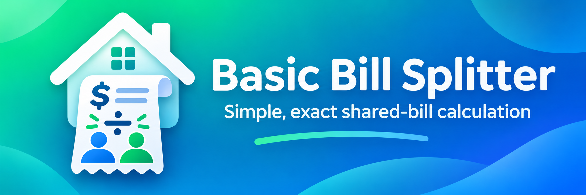

# Basic Bill Splitter



A Material 3 Flutter app for splitting one residential bill at a time. The
interface uses the pure-Dart calculation engine and keeps a single in-memory
draft while navigating between steps. Android is the primary target. The launcher
uses the short name **Splitter**; the full product name remains
Basic Bill Splitter.

## Calculation workflow

Start on Home, which displays the project banner and six bill buttons:
Electricity, Water, Internet, Rent, LPG, and Misc, each with a Material icon.
Each button starts a new draft with the category's default allocation method.

Five tabs—**Details**, **Households**, **Usage**, **Review**, and **Results**—show workflow progress. A tab becomes available only after its preceding step validates; available earlier tabs can be revisited directly.

1. **Details** — check the selected category, choose the allocation method, enter the PHP amount and inclusive billing period, and supply total consumption for hybrid. When saved bills exist for that category, a new draft proposes the day after the latest saved period and a calendar-month period.
2. **Households** — name households and set each headcount with the minus/value/plus stepper (0–10). Zero is selectable for editing, but each participating household must have 1–10 occupants to continue. Clear resets this section to one default household and occupant.
3. **Usage** — optionally enter measured usage and choose manual days, Full Period, or date ranges. Manual days must fit the billing period; ranges must be inside it and cannot overlap for the same occupant, including shared endpoints. Clear resets usage and duration fields while preserving household and bill details.
4. **Review** — inspect the bill, household, and occupant inputs. Calculate recomputes from the current validated draft.
5. **Results** — view household totals and, for hybrid/person-days, reconciled occupant amounts. Equal-per-household shows occupant inputs without inventing individual monetary shares. Save stores the current calculation on this Android device; Share creates a PNG card without saving it. Exit offers Save & Exit, Exit Without Saving, and Cancel when the current calculation is unsaved or changed.

Category defaults are Electricity and Water → hybrid; Internet, Rent and LPG →
person-days; Miscellaneous → equal per household. Selecting a category applies
its default. The method can then be overridden for this bill. Measured inputs
do not affect the two non-hybrid methods.

Amounts accept plain decimal digits with up to two decimal places (for example
`1234.56`) and convert directly to integer cents. Results use PHP formatting,
such as `₱1,234.56`. Review and Results display continuous quantities with
exactly two decimal places, including trailing zeros. Dates keep their date
format; headcounts and occupancy-day counts remain integers. Display rounding
never changes the original entry text, calculator inputs, weights, or
intermediate precision.
Reusable presentation helpers are in `lib/workflow/bill_draft.dart`.
Choose Billing Period opens one start/end date-range calendar. The read-only
summary below it uses `dd MMM yyyy - dd MMM yyyy` with English month abbreviations;
billing dates have no separate editable fields. Confirming updates the pair,
and cancelling preserves the selected dates. Individual occupancy ranges retain
both their calendar picker and manual `YYYY-MM-DD` fields. Occupancy calendars
are limited to the billing period, and multiple separate ranges remain supported.
Field errors prevent advancing until corrected; aggregate measured usage is
validated by the engine before Review.

Households have consistent accent borders across Households, Usage & Duration,
Review, and Results. Prominent names and nested occupant sections identify each
group without relying on color alone. Accents remain assigned to the same
household when other households are removed or added.

Available tabs and Back navigation preserve the in-memory draft. Revisiting an input from Results asks for confirmation; simply viewing inputs keeps the current results, while editing requires a new calculation. Clear actions confirm when they would discard entered values. Reducing and increasing a headcount retains inactive occupant entries until Clear is used. Household removal requires confirmation. Leaving Home with meaningful unsaved inputs also requires confirmation. Drafts are not restored after process termination.

Saved calculations are stored in an app-private, versioned SQLite database on Android. A saved record is assigned to the calendar month containing the greatest number of billing-period days; ties go to the later month. Only one record per category and assigned month can be saved. Replacing a conflicting bill requires confirmation. Saving an unchanged calculation does not create a duplicate. If a saved result is edited and recalculated, Save updates that record; changing its assigned month moves it, and a destination conflict also requires confirmation. Database failures leave the current calculation available and report an error.

New drafts propose the next billing period from the latest saved end date for that category. Manually confirmed periods that overlap another saved period of the same category show a warning, but users may continue. History is available from the app menu: choose a bill category to view annual monthly amounts and saved bills, then open a read-only snapshot with Card and Details views. Share exports the same results card as a PNG from current Results or History; Android opens the system share chooser. History and sharing read app-private saved records or the current calculation and work offline. Settings and ZIP Backup/Restore are not implemented. The Results Exit action returns Home and offers Save & Exit, Exit Without Saving, or Cancel when needed. The app-menu Exit command closes the Android activity.
The Home footer places Visit GitHub and the app version near the bottom of the
visible screen, above system insets. It scrolls with the page on shorter displays
or with larger text. Visit GitHub opens the repository in an external browser.
An Android platform channel handles that link and reads the installed package
version for Home and About, keeping the displayed version consistent with the
Flutter build metadata. No additional dependency or permission is needed.

The locally bundled black and white GitHub Invertocat PNGs come unchanged from
[GitHub's official logo download](https://brand.github.com/GitHub_Logos.zip).
They appear only beside the repository link, with clear space and theme-appropriate
contrast, following the [GitHub logo guidelines](https://brand.github.com/foundations/logo).
GitHub and the Invertocat mark are trademarks of GitHub, Inc.; the link does not
imply sponsorship or endorsement.

The entry point is `lib/main.dart`. `lib/app/` contains Home, the shared menu,
and the Android platform-channel wrapper. `lib/workflow/bill_workflow.dart`
renders the steps; `lib/workflow/bill_draft.dart` owns transient inputs, parsing
and form validation. Shared date-range fields and household sections live
alongside the workflow. Widgets do not implement allocation formulas.

## Calculation engine

Use `lib/calculation/bill_models.dart` for immutable bill, household, occupant,
and result models, and `lib/calculation/bill_calculator.dart` for
`BillCalculator.calculate`. The engine has no Flutter or third-party imports.

Each bill supplies a nonnegative integer `totalAmountCents` and a list of
participating households. Each household contains its participating occupants;
list lengths define headcounts rather than maintaining separate counts. Every
occupant supplies positive integer `occupancyDays` and may supply a
`measuredConsumption`. These are inputs for this bill only.

Supported methods:

- `AllocationMethod.hybrid`: requires positive `totalConsumption`. The unit rate
  is the bill amount divided by total consumption. Subtract all measured usage,
  then distribute residual consumption by occupancy days across **all**
  occupants, including those with measurements. An occupant's unrounded charge
  is `rate * (measuredUsage + residualUsage * days / totalPersonDays)`, with
  missing measured usage treated as zero. Sum these charges by household.
- `AllocationMethod.personDays`: split the bill by each household's total
  occupancy days divided by all participating occupancy days.
- `AllocationMethod.equalPerHousehold`: split the bill equally among households,
  irrespective of their occupant counts or days.

The hybrid rule deliberately supersedes the owner-provided legacy
`BillSplitter.py`, which excluded metered occupants from residual allocation.

### Validation and rounding

Calculation throws `ArgumentError` for empty household/occupant lists,
nonpositive occupancy days, negative bill amounts, negative/nonfinite
consumption, or measurements whose sum exceeds a supplied total consumption.
Total consumption is optional for the two non-hybrid methods; measurements do
not affect their weights, but supplied consumption values are still validated.
Zero bills are valid. Hybrid still requires positive consumption for a valid
unit-rate denominator.

Amounts are integer cents, bounded at `2^53 - 1` for Dart web portability.
Consumption uses one consistent unit per bill (for example kWh or cubic meters)
and accepts finite nonnegative doubles. The engine interprets each supplied
double's shortest decimal string exactly, using `BigInt` intermediate weights.
Pass source decimal values directly: a precomputed `0.1 + 0.2` remains
`0.30000000000000004`, rather than being silently adjusted with a tolerance.
Days are explicit counts; date ranges, billing-period limits, and currency
formatting belong to the calling workflow.

No individual charge is rounded before household aggregation. Household shares
are floored to cents, then leftover cents go to the largest fractional
remainders; ties favor household input order. Returned allocations preserve
that order and the original household objects, so duplicate display labels
remain distinct. Household amounts always sum to the original bill.

For hybrid and person-days, each `HouseholdAllocation.occupants` contains
immutable `OccupantAllocation` results in occupant input order. Once household
cents are reconciled, the engine distributes those cents within each household
using the same exact occupant weights and largest-remainder rule, with ties
favoring occupant input order. Occupant cents sum to household cents, including
zero-usage households and bills smaller than the number of occupants.
For equal-per-household, `occupants` is null because that method defines no
individual monetary allocation.

### Example

```dart
import 'package:basic_bill_splitter/calculation/bill_calculator.dart';
import 'package:basic_bill_splitter/calculation/bill_models.dart';

final bill = Bill(
  totalAmountCents: 10000,
  totalConsumption: 100,
  households: [
    Household(
      name: 'A',
      occupants: [
        Occupant(occupancyDays: 30, measuredConsumption: 20),
      ],
    ),
    Household(name: 'B', occupants: [Occupant(occupancyDays: 10)]),
  ],
);
final result = const BillCalculator().calculate(
  bill,
  method: AllocationMethod.hybrid,
);
// A: 8000 cents; B: 2000 cents; total: 10000 cents.
```

The app does not save household profiles, membership records, or payment tracking.
Completed calculations can be saved on Android; working drafts remain in memory.
History and PNG sharing are implemented. ZIP backup/restore and itemized billing are not implemented.

## Technical documentation

- [Architecture](docs/ARCHITECTURE.md) describes application layers, component responsibilities, and data flow.
- [Data storage](docs/DATA_STORAGE.md) documents saved records, persistence, and billing-period rules.

## Verification

```text
dart format lib test
flutter analyze
flutter test
flutter build apk --debug
git diff --check
```

Calculation and occupant reconciliation tests are in
`test/calculation/bill_calculator_test.dart`. Draft parsing, duration and
validation tests are in `test/workflow/bill_draft_test.dart`.
`test/widget_test.dart` covers Home category defaults, method overrides, menus,
native-channel calls, discard confirmation, navigation, form validation,
engine integration, household accent stability, and narrow layouts with larger
text in light and dark themes. `test/workflow/date_range_fields_test.dart`
covers paired calendar selection, editing, cancellation, and manual input.
Native-channel mocks verify Flutter calls and error presentation; they do not
prove that a physical browser opens or an Android activity exits correctly.

Automated widget tests do not establish physical-device keyboard, system-bar,
rotation, or accessibility behavior. Device checks should be reported
separately from the automated suite.

### Optional local regression fixture

`test/calculation/private_bill_regression_test.dart` loads
`test/fixtures/private/bill_regression.json`. The entire private fixture
directory is ignored by Git. Keep real bill data, participant names, and any
original photographs out of tracked source, documentation, and GitHub.

The JSON contains `method` (an `AllocationMethod` enum name),
`totalAmountCents`, optional `totalConsumption`, `periodDays`, and a
`households` list. Each household has a `name` and an `occupants` list with
`occupancyDays` and optional `measuredConsumption`. The `expected` object
provides `householdCents` and flattened `occupantCents` arrays in input order,
plus `totalAmountCents` and `personDays`. Additional descriptive metadata is
not used as a calculation input.

The runner checks expected allocations and exact occupant, household, and bill
reconciliation without printing private values in assertion failures. Invalid
or unreadable fixtures fail with a generic diagnostic; inspect the local JSON
to investigate. If the fixture is absent, the test is explicitly **skipped**,
not passed. The public suite remains runnable without it.

Set the process environment variable `BILL_SPLITTER_PRIVATE_FIXTURE` to use
another local fixture path; keep sensitive fixtures inside the ignored
directory. For example, this PowerShell command checks missing-fixture behavior
without moving or deleting an existing fixture:

```powershell
$env:BILL_SPLITTER_PRIVATE_FIXTURE = 'test/fixtures/private/not-supplied.json'
flutter test
Remove-Item Env:BILL_SPLITTER_PRIVATE_FIXTURE
```

Before sharing changes, use `git check-ignore -v -- test/fixtures/private/bill_regression.json`
and Git status to confirm the private data remains excluded. Never force-add
private fixture contents.

## Getting Started

Install the Flutter SDK, resolve dependencies with `flutter pub get`, then run
`flutter run` on a connected Android device.

A few resources to get you started if this is your first Flutter project:

- [Learn Flutter](https://docs.flutter.dev/get-started/learn-flutter)
- [Write your first Flutter app](https://docs.flutter.dev/get-started/codelab)
- [Flutter learning resources](https://docs.flutter.dev/reference/learning-resources)

For help getting started with Flutter development, view the
[online documentation](https://docs.flutter.dev/), which offers tutorials,
samples, guidance on mobile development, and a full API reference.
