# Application Architecture

## Overview

Basic Bill Splitter is an offline-first Flutter application for calculating one residential expense at a time. Flutter owns the workflow and presentation. A pure-Dart calculation layer owns allocation and cent reconciliation. On Android, a small native storage component persists completed calculation snapshots in app-private SQLite.

The current UI has five steps: Details, Households, Usage, Review, and Results. The working draft is transient; saved completed calculations are durable. Saved household profiles and persistent drafts are not part of the design.

## Layers and Data Flow

```mermaid
flowchart LR
  UI[Home and workflow UI] --> Draft[BillDraft parsing and validation]
  Draft --> Models[Typed Bill inputs]
  Models --> Engine[BillCalculator]
  Engine --> Results[BillAllocation and Results UI]
  Results --> Snapshot[SavedBillRecord snapshot]
  Snapshot --> Repository[BillRepository]
  Repository --> Channel[Flutter MethodChannel]
  Channel --> SQLite[Android SavedBillDatabase]
```

Data moves from **User Input → Draft Validation → Calculation Engine → Results → Persistent Storage**. The storage layer records the validated inputs and calculated output as a snapshot; it does not perform or revise allocations.

## Flutter Components

| Path | Responsibility |
| --- | --- |
| `lib/main.dart` | App entry point, Material 3 theme, and Home route |
| `lib/app/home_screen.dart` | Home category selection, fresh draft creation, saved-period continuity suggestion, and app shell |
| `lib/app/app_menu.dart` | About, How to, unavailable History/Settings entries, and activity Exit |
| `lib/app/app_platform.dart` | Android method-channel wrapper, repository instance, version lookup, repository link, and activity exit |
| `lib/workflow/bill_draft.dart` | Transient fields, category/method defaults, parsing, date and form validation, and typed Bill construction |
| `lib/workflow/bill_workflow.dart` | Five-step UI, validation-gated navigation, result invalidation, calculation, save/replace/exit flows, and result display |
| `lib/workflow/date_range_fields.dart` | Billing and occupancy date selection and input |
| `lib/workflow/household_section.dart` | Shared household grouping and presentation |
| `lib/calculation/bill_models.dart` | Typed Bill, Household, Occupant, and immutable allocation models |
| `lib/calculation/bill_calculator.dart` | Pure-Dart input validation, allocation, and deterministic cent reconciliation |
| `lib/storage/bill_repository.dart` | Repository contract, platform implementation, save result types, and in-memory test implementation |
| `lib/storage/saved_bill_record.dart` | Versioned record metadata, snapshot JSON encoding/decoding, and consistency validation |
| `lib/storage/billing_period.dart` | Pure-Dart assigned-month, inclusive overlap, and next-period rules |

## Workflow and Validation

Home creates a new `BillDraft` when a category is selected. The draft supplies the category's default allocation method and a default calendar period; Home may asynchronously replace that period with a continuity suggestion from the repository. It applies the suggestion only while the same draft still has its original default dates.

The workflow validates Details, Households, and Usage before enabling later tabs. Review validates the full draft again before Calculate. `BillDraft` parses currency to integer cents and consumption separately from widgets; `toBill()` is used only after field validation. The calculator repeats boundary validation independently.

The 0–10 headcount control is a presentation limit. Zero can be selected, but household validation requires 1–10 participants. Inactive occupant draft entries can remain when the count is reduced so restoring a count restores prior inputs; Clear explicitly resets those entries.

## Calculation and Results

`BillCalculator` is stateless and has no Flutter or storage dependencies. It returns household allocations in input order and occupant allocations for Hybrid and Person-days. Equal-per-household returns no occupant monetary allocation. Integer cents are reconciled using deterministic largest remainders, with input order breaking ties.

Input edits clear the in-memory bill and allocation. Results navigation is available only while a valid allocation exists. Reopening earlier inputs without editing retains the calculation; editing requires validation and calculation again. Review's Calculate action creates a fresh allocation from the current draft rather than using a prior result.

The workflow creates the saved snapshot only from the current calculated bill and allocation. A saved snapshot is a historical result and is not silently recomputed when the calculator changes.

## Android Storage Boundary and Errors

Dart code talks to the `BillRepository` abstraction. `PlatformBillRepository` encodes records and invokes the `basic_bill_splitter/app` method channel. The Kotlin `MainActivity` dispatches storage work on a single-thread executor and posts results back to the Flutter main thread. `SavedBillDatabase` owns SQLite operations. The same repository contract has an in-memory implementation for deterministic Dart tests.

Android storage failures return a platform-channel error; Dart does not interpret read failures as an empty database. The workflow keeps the current calculation when a save fails and presents an error message. Record decoding rejects unsupported schemas and inconsistent snapshots rather than accepting malformed data.

## Source and Test Map

| Path | Coverage |
| --- | --- |
| `test/calculation/` | Pure-Dart allocation, rounding, reconciliation, and optional private regression fixture |
| `test/workflow/` | Draft parsing/validation, billing-period helpers, and date-range controls |
| `test/storage/bill_repository_test.dart` | Repository save, conflict, movement, and integrity behavior |
| `test/widget_test.dart` | Home, workflow navigation, validation, calculation/result UI, storage-channel flows, and layout |

Automated repository and platform-channel tests do not establish physical-device behavior. Report Android hardware checks separately.
