# Application Architecture

## Overview

Basic Bill Splitter is an offline-first Flutter application for calculating one residential expense at a time. Flutter owns the workflow and presentation. A pure-Dart calculation layer owns allocation and cent reconciliation. On Android, a small native storage component persists completed calculation snapshots in app-private SQLite.

The current UI has five steps: Details, Households, Usage, Review, and Results. The working draft is transient; saved completed calculations are durable. Saved household profiles and persistent drafts are not part of the design.

## Layers and Data Flow

```mermaid
flowchart LR
  UI[Home and workflow UI] --> Draft[BillDraft parsing and validation]
  Draft --> Models[Typed Bill inputs]
  Models --> Engine[BillCalculator]
  Engine --> Results[BillAllocation and Results UI]
  Results --> Snapshot[SavedBillRecord snapshot]
  Snapshot --> Repository[BillRepository]
  Repository --> Channel[Flutter MethodChannel]
  Channel --> SQLite[Android SavedBillDatabase]
```



Data moves from **User Input → Draft Validation → Calculation Engine → Results → Persistent Storage**. The storage layer records the validated inputs and calculated output as a snapshot; it does not perform or revise allocations.

## Flutter Components

| Path | Responsibility |
| --- | --- |
| `lib/main.dart` | App entry point, root-owned Material 3 light/dark themes, persisted appearance/currency loading, and Home route |
| `lib/app/home_screen.dart` | Home category selection, fresh draft creation, saved-period continuity suggestion, and app shell |
| `lib/app/app_menu.dart` | About, How to, History category selection, Settings navigation, and activity Exit |
| `lib/app/app_platform.dart` | Android method-channel wrapper for repository access, SAF backup/restore, appearance/currency preferences, PNG sharing, version lookup, repository link, and activity exit |
| `lib/workflow/bill_draft.dart` | Transient fields, category/method defaults, parsing, date and form validation, and typed Bill construction |
| `lib/workflow/bill_workflow.dart` | Five-step UI, validation-gated navigation, result invalidation, calculation, save/replace/exit flows, and result display |
| `lib/workflow/date_range_fields.dart` | Billing and occupancy date selection and input |
| `lib/workflow/household_section.dart` | Shared household grouping and presentation |
| `lib/calculation/bill_models.dart` | Typed Bill, Household, Occupant, and immutable allocation models |
| `lib/calculation/bill_calculator.dart` | Pure-Dart input validation, allocation, and deterministic cent reconciliation |
| `lib/storage/bill_repository.dart` | Repository contract, platform implementation, save outcomes and replace-all operations, and in-memory test implementation |
| `lib/storage/saved_bill_record.dart` | Versioned record metadata, backward-compatible currency decoding, snapshot JSON encoding/decoding, and consistency validation |
| `lib/currency/currency.dart` | Fixed supported-currency list, code validation, and integer-cent formatting |
| `android/app/src/main/kotlin/com/hectordoesgorug/basic_bill_splitter/SavedBillBackup.kt` | Native version 1 ZIP creation, checksum, entry limits, and archive validation |
| `lib/storage/billing_period.dart` | Pure-Dart assigned-month, inclusive overlap, and next-period rules |
| `lib/history/bill_history_screen.dart` | Category/year History, monthly graph/list, stale-safe single-record deletion, and read-only Card/Details/Computation views |
| `lib/history/bill_computation_view.dart` | Plain-language explanation using stored inputs and saved allocations; never recalculates historical bills |
| `lib/app/settings_screen.dart` | Backup, validated full-replacement restore, current-draft clearing, saved-record wiping, Dark Mode, and Currency preferences |
| `lib/sharing/bill_share_card.dart` | Reusable current/saved snapshot card data and visual card |
| `lib/sharing/bill_share_export.dart` | Full-card PNG rendering and Android share-channel orchestration |

## Workflow and Validation

Home creates a new `BillDraft` when a category is selected. The draft supplies the category's default allocation method and a default calendar period; Home may asynchronously replace that period with a continuity suggestion from the repository. It applies the suggestion only while the same draft still has its original default dates.

The workflow validates Details, Households, and Usage before enabling later tabs. Review validates the full draft again before Calculate. `BillDraft` parses currency to integer cents and consumption separately from widgets; `toBill()` is used only after field validation. The calculator repeats boundary validation independently.

The 0–10 headcount control is a presentation limit. Zero can be selected, but household validation requires 1–10 participants. Inactive occupant draft entries can remain when the count is reduced so restoring a count restores prior inputs; Clear explicitly resets those entries.

## Calculation and Results

`BillCalculator` is stateless and has no Flutter or storage dependencies. It returns household allocations in input order and occupant allocations for Hybrid and Person-days. Equal-per-household returns no occupant monetary allocation. Integer cents are reconciled using deterministic largest remainders, with input order breaking ties.

Input edits clear the in-memory bill and allocation. Results navigation is available only while a valid allocation exists. Reopening earlier inputs without editing retains the calculation; editing requires validation and calculation again. Review's Calculate action creates a fresh allocation from the current draft rather than using a prior result.

The workflow creates the saved snapshot only from the current calculated bill and allocation. A saved snapshot is a historical result and is not silently recomputed when the calculator changes. History loads records through `BillRepository`, filters by category and assigned year/month, and displays stored allocations without invoking `BillCalculator`. Annual graphs represent one saved bill per populated month; a saved zero-cent value is distinct from a missing month.

Both current Results and saved History records map to `ShareBillCardData`. `ShareBillCard` renders the concise monetary card, and `bill_share_export.dart` captures the entire variable-height card as a PNG. The Android method channel passes PNG bytes to a native `FileProvider` share intent. The provider exposes only temporary files under its dedicated cache subdirectory; sharing does not save or change a bill.

`SettingsScreen` is opened from the shared app menu on Home or during a workflow. It reuses `BillRepository` for backup snapshots, validated full replacement, and saved-record wipe. Clear All calls the Home draft-reset callback and leaves the repository untouched. Successful restore or wipe also clears the active draft so a Results screen cannot retain stale saved-state references. The root `MyApp` owns Light/Dark theme and current-currency state; Settings persists both through Android preferences. Currency changes affect new/current unsaved calculations, while saved records render with their stored currency.

## Android Storage Boundary, Settings, and Errors

Dart code talks to the `BillRepository` abstraction. `PlatformBillRepository` encodes records and invokes the `basic_bill_splitter/app` method channel. The Kotlin `MainActivity` dispatches SQLite work on a single-thread executor and posts results back to the Flutter main thread. `SavedBillDatabase` owns SQLite operations. The repository contract also has an in-memory implementation for deterministic Dart tests.

`SettingsScreen` uses this same repository for listing, full replacement, and wipe; it does not access SQLite directly. History deletion targets a stable record ID and expected update timestamp through the same repository boundary. Backup and restore use Android's Storage Access Framework document picker. Native `SavedBillBackup` writes and validates the versioned ZIP payload, while Dart decodes each restored `SavedBillRecord` before it can request replacement. Replacement and wipe use database transactions. Dark Mode state belongs to `MyApp`; Android private preferences persist it separately from saved bills and ZIP archives.

Android storage failures return a platform-channel error; Dart does not interpret read failures as an empty database. Settings reports operation failures without claiming success, and a failed native replacement rolls back its transaction. Record decoding rejects unsupported schemas and inconsistent snapshots rather than accepting malformed data.

## Source and Test Map

| Path | Coverage |
| --- | --- |
| `test/calculation/` | Pure-Dart allocation, rounding, reconciliation, and optional private regression fixture |
| `test/workflow/` | Draft parsing/validation, billing-period helpers, and date-range controls |
| `test/storage/bill_repository_test.dart` | Repository save, conflict, movement, replacement, wipe, and integrity behavior |
| `test/widget_test.dart` | Home, workflow navigation, validation, calculation/result UI, storage-channel flows, and layout |
| `test/history/` | Category/year selection, graph/list state, and read-only saved details |
| `test/sharing/` | Reusable card content, full-card PNG output, and share-channel orchestration |
| `test/app/settings_screen_test.dart` | Settings backup/restore document-channel flows, confirmations, draft reset, wipe, and preference failures |

Automated repository and platform-channel tests do not establish physical-device behavior. Report Android hardware checks separately.

## Workflow Presentation Details

The Home footer shows Visit GitHub and the installed package version above
system insets. It scrolls on short screens or with larger text. The platform
channel opens the repository in an external browser and reads the installed
version for Home and About.

Billing dates use a paired calendar picker with centered OK and Cancel actions
and a read-only `dd MMM yyyy - dd MMM yyyy` summary using English month
abbreviations. Cancel preserves both dates. Occupancy ranges also support manual
`YYYY-MM-DD` fields; calendars are bounded to the billing period.

Household accent borders stay consistent across Households, Usage, Review, and
Results, including after other households are added or removed. Names and nested
occupant sections identify groups without relying on color alone.

Households Clear restores one default household and occupant. Usage Clear resets
duration and measured inputs while preserving household and bill details.
Clear actions confirm when entered work would be discarded, and household removal
requires confirmation. Meaningful unsaved inputs require confirmation before
leaving the workflow. Revisiting inputs from Results also asks for confirmation;
viewing without edits preserves the current result.

Amounts are parsed directly from decimal digits into integer cents. Review and
Results show money and continuous quantities with two decimal places, including
trailing zeros; counts remain integers. Display formatting never changes source
text, inputs, weights, or intermediate precision. Presentation helpers are in
`lib/workflow/bill_draft.dart`.

## Calculation engine

Use `lib/calculation/bill_models.dart` for immutable bill, household, occupant,
and result models, and `lib/calculation/bill_calculator.dart` for
`BillCalculator.calculate`. The engine has no Flutter or third-party imports.

Each bill supplies a nonnegative integer `totalAmountCents` and a list of
participating households. Each household contains its participating occupants;
list lengths define headcounts rather than maintaining separate counts. Every
occupant supplies positive integer `occupancyDays` and may supply a
`measuredConsumption`. These are inputs for this bill only.

Supported methods:

- `AllocationMethod.hybrid`: requires positive `totalConsumption`. The unit rate
  is the bill amount divided by total consumption. Subtract all measured usage,
  then distribute residual consumption by occupancy days across **all**
  occupants, including those with measurements. An occupant's unrounded charge
  is `rate * (measuredUsage + residualUsage * days / totalPersonDays)`, with
  missing measured usage treated as zero. Sum these charges by household.
- `AllocationMethod.personDays`: split the bill by each household's total
  occupancy days divided by all participating occupancy days.
- `AllocationMethod.equalPerHousehold`: split the bill equally among households,
  irrespective of their occupant counts or days.

The hybrid allocation rule supersedes the legacy `BillSplitter.py`
implementation, which excluded metered occupants from residual allocation.

### Validation and rounding

Calculation throws `ArgumentError` for empty household/occupant lists,
nonpositive occupancy days, negative bill amounts, negative/nonfinite
consumption, or measurements whose sum exceeds a supplied total consumption.
Total consumption is optional for the two non-hybrid methods; measurements do
not affect their weights, but supplied consumption values are still validated.
Zero bills are valid. Hybrid still requires positive consumption for a valid
unit-rate denominator.

Amounts are integer cents, bounded at `2^53 - 1` for Dart web portability.
Consumption uses one consistent unit per bill (for example kWh or cubic meters)
and accepts finite nonnegative doubles. The engine interprets each supplied
double's shortest decimal string exactly, using `BigInt` intermediate weights.
Pass source decimal values directly: a precomputed `0.1 + 0.2` remains
`0.30000000000000004`, rather than being silently adjusted with a tolerance.
Days are explicit counts; date ranges, billing-period limits, and currency
formatting belong to the calling workflow.

No individual charge is rounded before household aggregation. Household shares
are floored to cents, then leftover cents go to the largest fractional
remainders; ties favor household input order. Returned allocations preserve
that order and the original household objects, so duplicate display labels
remain distinct. Household amounts always sum to the original bill.

For hybrid and person-days, each `HouseholdAllocation.occupants` contains
immutable `OccupantAllocation` results in occupant input order. Once household
cents are reconciled, the engine distributes those cents within each household
using the same exact occupant weights and largest-remainder rule, with ties
favoring occupant input order. Occupant cents sum to household cents, including
zero-usage households and bills smaller than the number of occupants.
For equal-per-household, `occupants` is null because that method defines no
individual monetary allocation.

### Example

```dart
import 'package:basic_bill_splitter/calculation/bill_calculator.dart';
import 'package:basic_bill_splitter/calculation/bill_models.dart';

final bill = Bill(
  totalAmountCents: 10000,
  totalConsumption: 100,
  households: [
    Household(
      name: 'A',
      occupants: [
        Occupant(occupancyDays: 30, measuredConsumption: 20),
      ],
    ),
    Household(name: 'B', occupants: [Occupant(occupancyDays: 10)]),
  ],
);
final result = const BillCalculator().calculate(
  bill,
  method: AllocationMethod.hybrid,
);
// A: 8000 cents; B: 2000 cents; total: 10000 cents.
```

## Verification

Run these commands from the repository root. See [Progress](PROGRESS.md) for
historical results and pending release-candidate checks.

```text
dart format lib test
flutter analyze
flutter test
flutter build apk --debug
git diff --check
```

Calculation and occupant reconciliation tests are in
`test/calculation/bill_calculator_test.dart`. Draft parsing, duration and
validation tests are in `test/workflow/bill_draft_test.dart`.
`test/widget_test.dart` covers Home category defaults, method overrides, menus,
native-channel calls, discard confirmation, navigation, form validation,
engine integration, household accent stability, and narrow layouts with larger
text in light and dark themes. `test/workflow/date_range_fields_test.dart`
covers paired calendar selection, editing, cancellation, and manual input.
Native-channel mocks verify Flutter calls and error presentation; they do not
prove that a physical browser opens or an Android activity exits correctly.

Automated widget tests do not establish physical-device keyboard, system-bar,
rotation, or accessibility behavior. Device checks should be reported
separately from the automated suite.

### Optional local regression fixture

`test/calculation/private_bill_regression_test.dart` loads
`test/fixtures/private/bill_regression.json`. The entire private fixture
directory is ignored by Git. Keep real bill data, participant names, and any
original photographs out of tracked source, documentation, and GitHub.

The JSON contains `method` (an `AllocationMethod` enum name),
`totalAmountCents`, optional `totalConsumption`, `periodDays`, and a
`households` list. Each household has a `name` and an `occupants` list with
`occupancyDays` and optional `measuredConsumption`. The `expected` object
provides `householdCents` and flattened `occupantCents` arrays in input order,
plus `totalAmountCents` and `personDays`. Additional descriptive metadata is
not used as a calculation input.

The runner checks expected allocations and exact occupant, household, and bill
reconciliation without printing private values in assertion failures. Invalid
or unreadable fixtures fail with a generic diagnostic; inspect the local JSON
to investigate. If the fixture is absent, the test is explicitly **skipped**,
not passed. The public suite remains runnable without it.

Set the process environment variable `BILL_SPLITTER_PRIVATE_FIXTURE` to use
another local fixture path; keep sensitive fixtures inside the ignored
directory. For example, this PowerShell command checks missing-fixture behavior
without moving or deleting an existing fixture:

```powershell
$env:BILL_SPLITTER_PRIVATE_FIXTURE = 'test/fixtures/private/not-supplied.json'
flutter test
Remove-Item Env:BILL_SPLITTER_PRIVATE_FIXTURE
```

Before sharing changes, use `git check-ignore -v -- test/fixtures/private/bill_regression.json`
and Git status to confirm the private data remains excluded. Never force-add
private fixture contents.


## Build Configuration and Fresh Checkouts

`pubspec.lock` records resolved packages; `pubspec.yaml` keeps the Dart SDK
constraint at `^3.14.0`. The local resolved package configuration inspected during
repository review records Flutter 3.50.0 and Dart 3.14.0. The repository does not
pin an exact Flutter SDK revision. Record the SDK revision and Java/Android
toolchain when preparing a release candidate.

Android configuration declares AGP 9.3.1, Kotlin plugin 2.4.20, and Gradle 9.5.0.
Java source/target and Kotlin JVM target are 17. Compile/minimum/target Android
SDK and NDK versions come from the selected Flutter SDK rather than fixed values
in the app build file. These settings do not establish tested device coverage.

The tracked `android/gradle/wrapper/gradle-wrapper.properties` selects the Gradle
distribution, but `android/.gitignore` excludes `gradlew`, `gradlew.bat`, and
`gradle-wrapper.jar`. A fresh checkout therefore cannot directly run those
scripts. The inspected local Flutter tooling (`GradleUtils.getExecutable` and
`injectGradleWrapperIfNeeded`) copies missing wrapper components from the
Flutter cache before invoking Gradle. This explains the current Flutter build
path; it is not evidence of a successful fresh-checkout build.

Before release, verify a separate fresh checkout with the recorded Flutter SDK
and dependency lockfile. Decide whether to retain Flutter-managed wrapper
bootstrapping or explicitly track wrapper components. Do not regenerate the
platform project merely to obtain them. Local SDK paths, signing properties,
keystores, caches, private fixtures, and generated outputs remain excluded.

## Production Release Signing

Release builds use a dedicated Gradle signing configuration. Set
`BILL_SPLITTER_KEY_PROPERTIES` to the absolute path of a private
`key.properties` file outside the repository. The file must contain
`storeFile`, `storePassword`, `keyAlias`, and `keyPassword`. For example,
use forward slashes in Windows properties paths:

```properties
storeFile=C:/private-signing/basic-bill-splitter-release.jks
storePassword=<keystore-password>
keyAlias=<key-alias>
keyPassword=<key-password>
```

Set the variable in the PowerShell session used for Flutter/Gradle builds:

```powershell
$env:BILL_SPLITTER_KEY_PROPERTIES = 'C:\private-signing\key.properties'
```

To persist it for the current Windows user, run this in PowerShell:

```powershell
[Environment]::SetEnvironmentVariable(
    'BILL_SPLITTER_KEY_PROPERTIES',
    'C:\private-signing\key.properties',
    'User'
)
```

A persistent user variable is available to newly launched terminals and
applications. Restart Android Studio and its terminals after setting it so
Gradle inherits the value. The variable holds only the properties-file path,
never a password.

Gradle does not fall back to a repository-local properties file. Release tasks
require the environment variable to name an absolute, readable regular file
outside the repository. Gradle also requires all four properties and an
existing readable keystore at an absolute path outside the checkout. Missing or
invalid configuration fails release tasks with a message that does not print
property values. Debug builds work without this environment variable and
production-signing credentials.

Keep both the properties file and keystore outside Git and outside the checkout.
The repository ignores `android/key.properties` and repository-local JKS and
keystore files as a safeguard; use the external properties file for release
signing. Do not place passwords in tracked files, command history, or logs.

Create a private key only after choosing secure storage. Android Studio's
**Build > Generate Signed Bundle / APK** wizard can create a keystore;
choose a path outside the repository and store it securely. Alternatively, use
the JDK's `keytool` interactively so it prompts for passwords:

```text
keytool -genkeypair -v -storetype JKS -keystore <absolute-path-outside-repository> -alias <key-alias> -keyalg RSA -keysize 2048 -validity 10000
```

Record the alias and recovery instructions in a password manager. Keep separate
secure backups of the keystore and its passwords; losing the private key may
prevent ordinary signed updates to existing installations.

Once the established key and external properties file are configured, build a
signed APK with:

```text
flutter build apk --release
```

Inspect the APK certificate with Android SDK Build Tools' `apksigner`:

```text
apksigner verify --print-certs <path-to-apk>
```

Keep using the same signing identity for later APK updates. Android accepts an
in-place update only when the installed app and update have compatible signing
identities. Losing the key can require users to uninstall the existing app
before installing a differently signed build, removing its app-private data.

Key creation, configuration, backup, and certificate checks are separate from
building, installing, and publishing a release.
